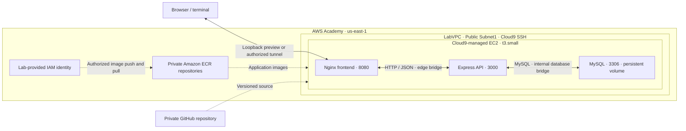

# Track B architecture

EquipTrack uses an Nginx frontend and an Express API, with MySQL as a third container. The stack was verified locally and on the Cloud9-managed Cloud9-managed EC2 · t3.small `EquipTrack-SSH` in `us-east-1`. See the [editable SVG](architecture.svg).

Only the frontend is bound to the host loopback address. The backend joins both Docker networks. MySQL joins only the internal database network and keeps its data in a named volume. The Academy deployment uses Cloud9 SSH. Tests run at the host’s loopback address. ECR operations use the temporary lab identity. Both private repositories were verified with tag `week12`. The test stack ran the same images built on its EC2 host. Database traffic uses the application MySQL account and parameterized queries.
