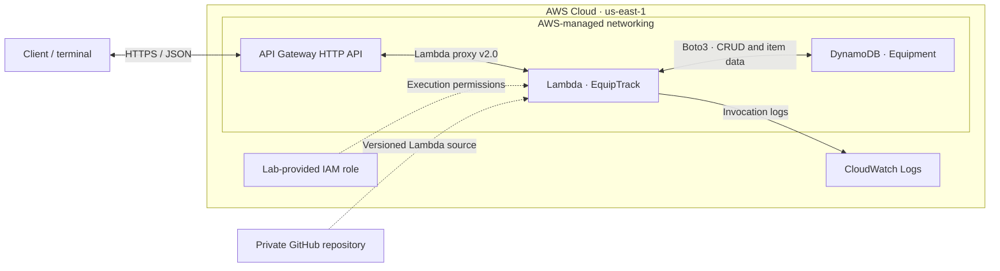

# Proposed Track C architecture

The planned region is `us-east-1`, subject to the AWS Academy lab's service permissions. The application runs on AWS-managed networking and does not require a customer-managed VPC. See the [editable SVG](architecture.svg).

All cloud components in this diagram are planned. The Lambda execution role must allow the four item operations and CloudWatch logging. Prefer IAM-authorized routes where the lab supplies an authorized test identity. Use dummy data and keep endpoints out of repository documentation.
