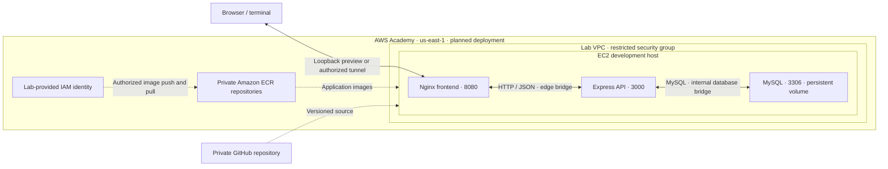

# Track B architecture

EquipTrack uses an Nginx frontend and an Express API, with MySQL as a third container. The application was verified locally in Docker. The target host is one EC2 instance in the AWS Academy lab, in `us-east-1`. See the [editable SVG](architecture.svg).

Only the frontend is bound to the host loopback address. The backend joins both Docker networks. MySQL joins only the internal database network and keeps its data in a named volume. A cloud deployment uses the network controls provided by the Academy lab and temporary IAM credentials for ECR. Database traffic uses the application MySQL account and parameterized queries.
