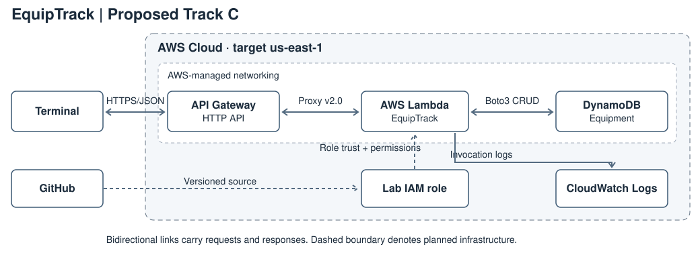

# EquipTrack: Cloud-Based Equipment Inventory Management on AWS

Muhammad Khoirunas · 24/533373/TK/59083 · Universitas Gadjah Mada  
Cloud Computing · Week 12 — Design & AWS Setup · Track B (Containers)

## 1. Use Case and Chosen Track

Laboratory staff need an inventory record that stays current when equipment quantities or conditions change. EquipTrack lets staff create, find, update, and delete a record by UUID. Track B gives the frontend and API separate application images and runs MySQL on a private container network.

The AWS Academy Lab Project - Microservices and CI/CD Pipeline Builder (195218) ran through Vocareum in `us-east-1`. The available Lambda role was for the lab's internal ECS enforcer, and AWS denied `iam:GetRole` on the Vocareum role. Track B follows the development tools documented for this course.

## 2. Data Entity and CRUD Endpoints

| Equipment attribute | Type and constraint |
| --- | --- |
| `equipment_id` | UUID string, primary key |
| `name` | Required string, 1–120 characters |
| `category` | Required string, 1–80 characters |
| `quantity` | Non-negative integer, up to JavaScript's safe integer limit |
| `condition` | Good, Damaged, or Maintenance |
| `created_at` | UTC creation timestamp |
| `updated_at` | UTC last-update timestamp |

| Method and path | Operation | Success |
| --- | --- | --- |
| `POST /equipment` | Create | 201 |
| `GET /equipment/{id}` | Read by UUID | 200 |
| `PUT /equipment/{id}` | Update mutable fields | 200 |
| `DELETE /equipment/{id}` | Delete by UUID | 204 |

Invalid input returns 400. Missing records return 404. Duplicate identifiers return 409. Unexpected errors return 500.

## 3. Architecture, Network, and Security

Nginx serves the inventory form and forwards API requests to Express. Express uses parameterized SQL on an internal bridge network to reach MySQL, which stores data in a named volume. Only Nginx binds to host loopback. The Cloud9 IDE connects through the AWS-managed SSH rule. The test client uses host loopback. The lab identity provides temporary authorization for ECR.

## 4. Git Repository and Deployment Plan

The [private repository](https://github.com/nastarynaz/equiptrack-aws) includes the source, Dockerfiles, schema, deployment plan, and smoke tests. Both application images built on macOS and in AWS Academy. Cloud9 SSH provided an EC2 t3.small development host in LabVPC / Public Subnet1. The deployed stack passed all nine CRUD smoke checks, a MySQL health query, and malformed JSON rejection. Direct EC2 and Cloud9 SSM attempts were blocked by IAM. Cloud9 offered Amazon Linux 2023, which was used for the host. The private ECR repositories `equiptrack-frontend` and `equiptrack-backend` both returned verified digests for `week12`. Future development would add inventory listing and user authentication before broader use.

## 5. Cost Management

Vocareum displayed $0 used of a $40 lab allowance at the session check. The cloud environment uses one development host with a 30-minute idle timeout. The Compose stack requires no public application ports, dedicated database service, or load balancer.
